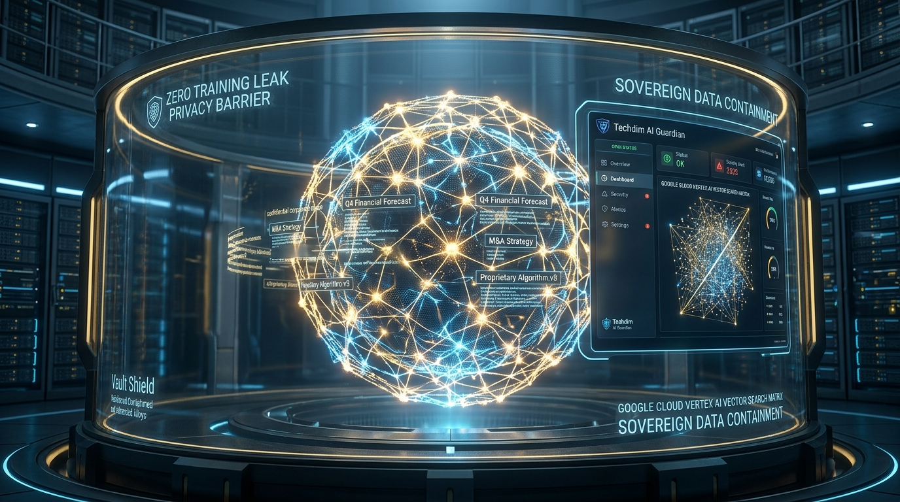
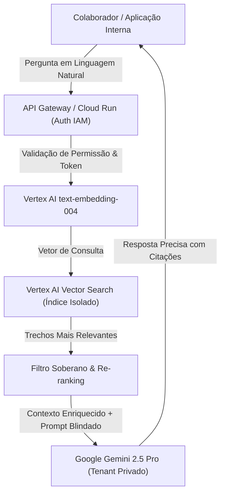

# 🧠 Enterprise Sovereign RAG GCP
## Arquitetura de IA Generativa Soberana e Busca Semântica Empresarial no Google Cloud



[](https://techdimbr.github.io/techdimbr/)
[](https://www.techdim.com.br)
[](https://cloud.google.com/vertex-ai)
[](README.md)
[](https://cloud.google.com/run)
[](LICENSE)

> **Pipeline de Retrieval-Augmented Generation (RAG) soberano para dados corporativos confidenciais. Garante que nenhum documento interno seja utilizado para retreinamento de modelos de terceiros, com encriptação de ponta a ponta e controle estrito de acesso via Cloud IAM.**

---

## 🏛️ Visão Geral & Proposta de Valor

Empresas enfrentam um dilema crítico: como permitir que colaboradores usem Inteligência Artificial Generativa para consultar documentos internos (estratégias, contratos, código proprietário) sem correr o risco de exfiltração de dados ou de alimentar o treinamento de LLMs comerciais abertas?

O **Enterprise Sovereign RAG GCP** resolve essa barreira com uma infraestrutura corporativa soberana:
1. **Zero Data Training Guarantee:** Utiliza contratos corporativos da Vertex AI e APIs do Google Cloud onde os dados nunca saem do tenant seguro do cliente e não são retidos para treinamento de modelos fundacionais.
2. **Busca Vetorial em Milissegundos:** Indexa bases documentais com `text-embedding-004` e gerencia consultas semânticas no Vertex AI Vector Search com suporte a bilhões de vetores.
3. **Governança Granular de Acesso:** Cada consulta ao RAG valida as permissões de acesso do colaborador, garantindo que um analista não receba resumos de documentos restritos à diretoria.

---

## 🏗️ Topologia da Arquitetura RAG Soberana



---

## ⚡ Início Rápido

### Comandos de Operação
```bash
# 1. Clonar o repositório
git clone https://github.com/Techdimbr/enterprise-sovereign-rag-gcp.git
cd enterprise-sovereign-rag-gcp

# 2. Inicializar o ambiente
./iniciar.sh

# 3. Testar a busca semântica em memória governada
python3 03_APLICACAO/src/rag_engine.py --demo
```

---

## 🛡️ Governança & Contato Corporativo
- **Autor:** Deivis Írio Mayer (Kether_1)
- **Entidade:** TECHDIM INOVA SIMPLES (I.S.) - ME · CNPJ 61.933.926/0001-24
- **Website Oficial:** [https://www.techdim.com.br](https://www.techdim.com.br)
- **Portal de Soluções:** [https://techdimbr.github.io/techdimbr/](https://techdimbr.github.io/techdimbr/)
